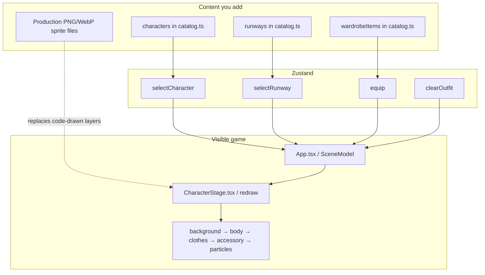

# Runway Wardrobe: learning and asset guide

This guide explains the first playable version of the wardrobe game. It is written for a junior developer who wants to safely change the visuals, add an item, or understand why a tap in the wardrobe changes the character on the runway.

## 1. How the code is related

The app deliberately separates **data**, **state**, **React user interface**, and **PixiJS rendering**. That separation is what makes the project easy to grow without turning one component into a large, hard-to-debug file.

| Area | Main file(s) | Responsibility |
| --- | --- | --- |
| App composition | `src/app/App.tsx` | Connects state to the screen and creates the `SceneModel` for the game renderer. |
| Domain types | `src/features/dressing/model.ts` | Defines valid slots, characters, runway IDs, clothing records, and the state shape. |
| Game content | `src/features/dressing/catalog.ts` | Contains the character, runway, and clothing catalog. This is the first place to add content. |
| Shared game state | `src/features/dressing/store.ts` | The single Zustand store for the selected character, set, outfit, wardrobe visibility, and effects. |
| React controls | `src/features/dressing/components/` | Buttons and wardrobe cards. They read from the store and call store actions. |
| PixiJS scene | `src/features/game/CharacterStage.tsx` | Draws the runway, character layers, clothing, and particles on a canvas. |
| Mobile styling | `src/styles/global.css` | Layout, accessible touch targets, panel animation, and wardrobe-card presentation. |

### The interaction path

When a player chooses **Berry knit**, this is the path through the application:

```mermaid
flowchart LR
  A[Player taps Berry knit] --> B[Wardrobe.tsx]
  B --> C[equip(item)]
  C --> D[useDressingStore in store.ts]
  D --> E[outfit.top and effectNonce update]
  E --> F[App.tsx creates a new SceneModel]
  F --> G[CharacterStage.tsx redraws Pixi layers]
  G --> H[Pink top appears]
  E --> I[effectNonce changes]
  I --> J[Particle burst plays]
```

There are two categories of data:

- **Catalog data** is the list of things that exist: `wardrobeItems`, `characters`, and `runways`. It does not change while a player is using the game.
- **Game state** is the player’s current choice: for example, `outfit.top === 'top-berry'`. It changes often and belongs in Zustand.

Do not put the catalog into Zustand unless it must change at runtime, for example after downloading a player-owned collection from a server.

## 2. Key areas to learn

Learn these in order. Each topic directly unlocks useful changes in this game.

1. **TypeScript data modelling** — Read `model.ts`, then `catalog.ts`. Learn interfaces, union types such as `ClothingSlot`, and `Record`. This prevents a shirt from accidentally being equipped as an accessory.
2. **React props and rendering** — Read `App.tsx`, `Wardrobe.tsx`, and `CharacterPicker.tsx`. Learn how a component receives data and maps an array to buttons.
3. **Zustand state and selectors** — Read `store.ts` alongside `App.tsx`. Learn why each component selects only the state it needs.
4. **PixiJS display objects** — Read `CharacterStage.tsx`. Learn `Application`, `Container`, `Graphics`, the ticker, and cleanup in `useEffect`.
5. **Asset pipelines** — Learn how a consistently aligned character and clothing sprite set replaces the current code-drawn prototype.
6. **Mobile performance and accessibility** — Read `global.css`; then test controls on a real phone. Optimizing visual assets is as important as optimizing code.

## 3. Critical functions and asset map



| What you want to change | Start here | Then inspect | Notes |
| --- | --- | --- | --- |
| Add a clothing card | `catalog.ts` → `wardrobeItems` | `Wardrobe.tsx` | The UI creates cards from this array automatically. |
| Change a valid slot | `model.ts` → `ClothingSlot` | `catalog.ts`, `store.ts`, `Wardrobe.tsx`, `CharacterStage.tsx` | Adding `shoes`, for example, touches every listed file. |
| Change a player action | `store.ts` | Relevant component | Actions are the only place shared state should be changed. |
| Change character layering | `CharacterStage.tsx` → `redraw` | `SceneModel` in `App.tsx` | Keep layer order predictable; it prevents clothes appearing behind the body. |
| Replace prototype clothes with art | `CharacterStage.tsx` | New sprite manifest in `catalog.ts` | See the next section before drawing final art. |
| Change the wardrobe visual card | `Wardrobe.tsx` | `global.css` → `.clothing-card` / `.garment-preview` | This only changes the menu preview, not the runway sprite. |
| Change the runway scene | `catalog.ts` → `runways` | `CharacterStage.tsx` background and runway code | Later, replace color pairs with image paths. |
| Change an equip burst | `CharacterStage.tsx` → `redraw(true)` and `tick` | `store.ts` → `effectNonce` | See “Changing particles.” |

## 4. Working with game assets

### What exists today

The prototype currently draws the character with PixiJS `Graphics` shapes. That is intentional: it lets us validate the dressing flow before commissioning final visual art. The current art decision points are inside `CharacterStage.tsx`:

- `background` and `runway` draw the set.
- `legs`, `body`, and `head` draw the base character.
- `outfit.top`, `outfit.bottom`, and `outfit.accessory` draw each equipped layer.
- The special `item.id` checks temporarily give individual prototype pieces different shapes.

For real art, replace those `Graphics` blocks with `Sprite` objects loaded from files. Avoid adding a long chain of `if (item.id === ...)` statements for production clothing; use asset metadata instead.

### Asset contract: the rule that prevents misaligned clothing

Every sprite for a specific character pose must share the same logical canvas and anchor point. For the current stage, use a design canvas of **390 × 740** pixels (or a clean multiple such as 780 × 1480 for retina source art), because that is the coordinate system the stage scales from.

Recommended folder layout:

```text
public/assets/
  characters/
    nova/
      base.webp
      hair-default.webp
      tops/
        berry-knit.webp
      bottoms/
        denim-skirt.webp
      accessories/
        sunset-shades.webp
  runways/
    midnight.webp
  particles/
    sparkle.webp
```

Recommended export rules:

- Use a transparent background for every character and clothing layer.
- Export every wearable in the exact same pose, crop, width, height, and anchor as the matching base character.
- Keep the feet/ground contact at the same pixel position in every character asset.
- Separate clothing slots: a top must not include legs or accessories.
- Use WebP for large opaque or semi-transparent art; use PNG when transparency quality or your art pipeline needs it.
- Keep a source file (for example, Figma, PSD, or Aseprite) separate from optimized web exports.
- Create a small written layer order and follow it in every asset review.

Suggested production layer order:

```text
runway background
shadow
base body
hair behind body, if needed
bottom
top
shoes
hair in front, if needed
accessory
particle effect
```

### Metadata to add before loading real sprites

Extend `ClothingItem` in `model.ts` with an optional asset path, then provide it in the catalog. For example:

```ts
interface ClothingItem {
  id: string
  slot: ClothingSlot
  name: string
  color: string
  accent: string
  description: string
  assetPath: string
}

{
  id: 'top-berry',
  slot: 'top',
  name: 'Berry knit',
  color: '#EC4899',
  accent: '#F9A8D4',
  description: 'Fitted ribbed knit',
  assetPath: '/assets/characters/nova/tops/berry-knit.webp',
}
```

Then update `CharacterStage.tsx` to load textures with PixiJS `Assets.load` and add a `Sprite` at the same base anchor. When you introduce multiple base characters with different proportions, store paths by `characterId` rather than assuming that Nova’s clothing fits Mika and Sky.

## 5. Zustand in this specific game

Zustand is the small shared memory of the game. It is useful here because the wardrobe panel, character picker, runway picker, and Pixi canvas are separate components that need to agree on one outfit.

### Read the store as “state plus verbs”

In `store.ts`:

- **State (nouns):** `activeCharacterId`, `activeRunwayId`, `outfit`, `wardrobeOpen`, and `effectNonce`.
- **Actions (verbs):** `selectCharacter`, `selectRunway`, `equip`, `toggleWardrobe`, and `clearOutfit`.

`equip(item)` updates only the selected item’s slot:

```ts
outfit: { ...state.outfit, [item.slot]: item.id }
```

The `...state.outfit` part makes a new object instead of mutating the existing state. Treating state as immutable is important: React and Zustand can then tell that a meaningful change happened.

### Why `effectNonce` exists

Equipping an item needs two outcomes:

1. Save the selected garment ID in `outfit`.
2. Replay a visual effect, even if the player picks the same garment again.

`effectNonce` changes to `Date.now()` whenever that action happens. `CharacterStage` listens for that change and calls `redraw(true)`, which starts the particle burst. The nonce is an **event signal**, not outfit data.

### Selector rule for this project

Use narrow selectors so a component only subscribes to what it uses:

```ts
const wardrobeOpen = useDressingStore((state) => state.wardrobeOpen)
const toggleWardrobe = useDressingStore((state) => state.toggleWardrobe)
```

Avoid building a new object directly inside a selector unless you also use Zustand’s `useShallow` helper. A new object has a new identity every time, which can cause unnecessary rendering and, in some cases, React snapshot warnings. This project’s `App.tsx` selects primitive/store references individually and uses `useMemo` to create the derived `SceneModel`.

### Practical learning exercises

Try these in order, committing each exercise separately:

1. Add one new top to `wardrobeItems` and verify that a card appears.
2. Add a `shoes` slot to the type model, state, catalog, wardrobe UI, and renderer.
3. Add `selectedItemId` to highlight an item before equipping it.
4. Add Zustand `persist` middleware so an outfit survives refresh.
5. Add Zustand `devtools` middleware and inspect actions while testing.
6. Split a future server-backed player collection into its own store slice rather than mixing it with transient UI state.

## 6. Changing particles and animation

The equip effect is intentionally simple and easy to tune. In `CharacterStage.tsx`:

| Value or area | Current purpose | Safe experiment |
| --- | --- | --- |
| `for (let index = 0; index < 18; ...)` | Number of particles | Try 10–24 on mobile. More particles cost more rendering time. |
| `circle` radii `5` and `3` | Particle size | Make confetti more subtle with `2` and `4`. |
| `particleVelocity` | Direction, speed, and rotation | Reduce the multipliers for a gentle “poof”; increase them for a celebratory burst. |
| `particleLife = 32` | Effect duration in frames | Use 20–40. Do not assume frames equal milliseconds. |
| `particle.alpha = particleLife / 32` | Fade-out curve | Replace with a squared value for a faster final fade. |
| ticker’s `Math.sin(...)` | Idle character bob | Lower the `3` pixel offset for subtler motion. |

When using final art, replace circles with a small transparent sparkle texture. Preload the texture once, then create a limited number of sprites during a burst. Keep the effect lightweight:

- Reuse a pool of particle sprites instead of creating hundreds every tap.
- Limit mobile effects to a few dozen visible sprites.
- Pause or reduce effects when `prefers-reduced-motion` is enabled.
- Profile on a real mid-range phone, not only a desktop browser.

## 7. Learning resources for a junior developer

Use the official material first; it stays closest to the tools used by this codebase.

1. [React: Quick Start](https://react.dev/learn) — Start with components, props, event handlers, and lists.
2. [React: Sharing State Between Components](https://react.dev/learn/sharing-state-between-components) — Helps explain why several game controls must coordinate around one outfit.
3. [Zustand: Learn](https://zustand.docs.pmnd.rs/learn/index) — Begin with its tutorial, then compare the example’s state/actions to `store.ts`.
4. [Zustand: Beginner TypeScript Guide](https://zustand.docs.pmnd.rs/learn/guides/beginner-typescript) — Read this before expanding the store; pay attention to types and selectors.
5. [PixiJS v8 API documentation](https://pixijs.download/release/docs/index.html) — Look up `Application`, `Container`, `Graphics`, `Sprite`, `Assets`, and `Ticker` as you edit the renderer.
6. [PixiJS v8 migration guide](https://pixijs.download/dev/docs/migrations.html) — Useful because many older tutorials use PixiJS v7 syntax.
7. [MDN: Using images in HTML](https://developer.mozilla.org/en-US/docs/Learn_web_development/Core/Structuring_content/HTML_images) and [MDN: Responsive images](https://developer.mozilla.org/en-US/docs/Learn/HTML/Multimedia_and_embedding/Responsive_images) — Helpful foundations for asset formats, paths, and loading trade-offs.

## 8. Conclusions and recommendations

1. Keep `catalog.ts` as the source of truth for game content and keep `store.ts` for player choices. This is the most important boundary in the project.
2. Before producing a large wardrobe, make one production-quality character, one runway, and one complete outfit using the asset contract above. Fix alignment and draw order once, then scale the catalog.
3. Replace the prototype’s item-ID conditionals in `CharacterStage.tsx` with sprite metadata as soon as real art arrives. This will make adding 100 outfits no harder than adding 10.
4. Keep Zustand focused on shared, interactive state. Put temporary hover state, animation-only values, and renderer internals in the relevant component unless other parts of the application need them.
5. Add saved outfits with Zustand `persist` only after the basic offline game feels correct; persistence makes state migration a concern later.
6. Establish an asset review checklist—canvas size, anchor, transparency, slot, and z-order—before accepting every new clothing export.
7. Treat a real mid-range phone as the final performance target. Small, cached WebP assets and restrained particle counts will matter more than clever code micro-optimizations.
